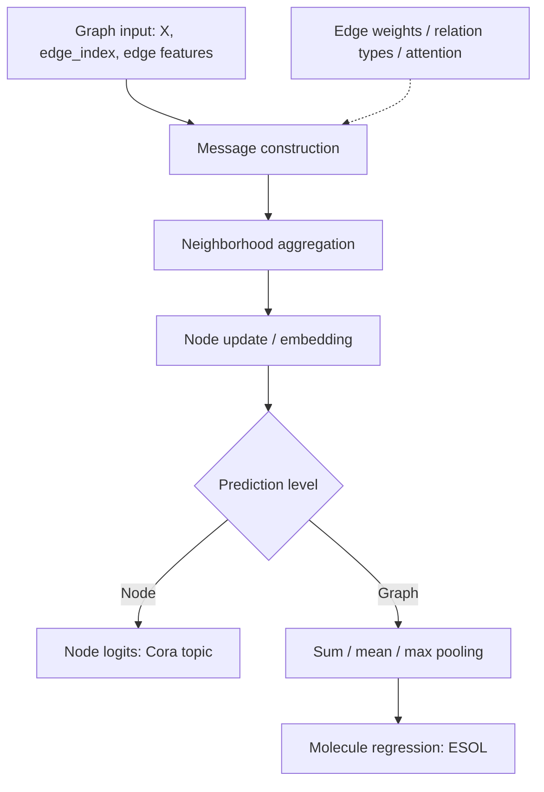
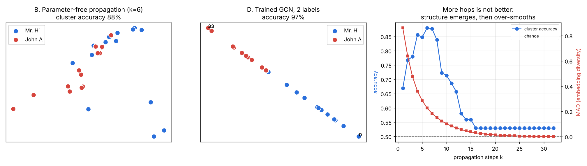
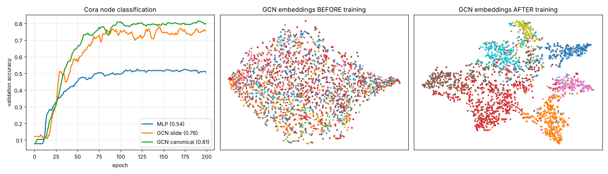
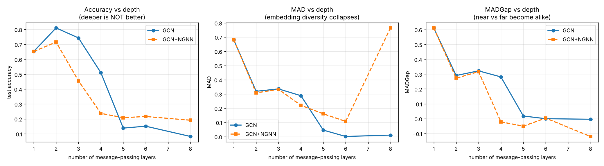
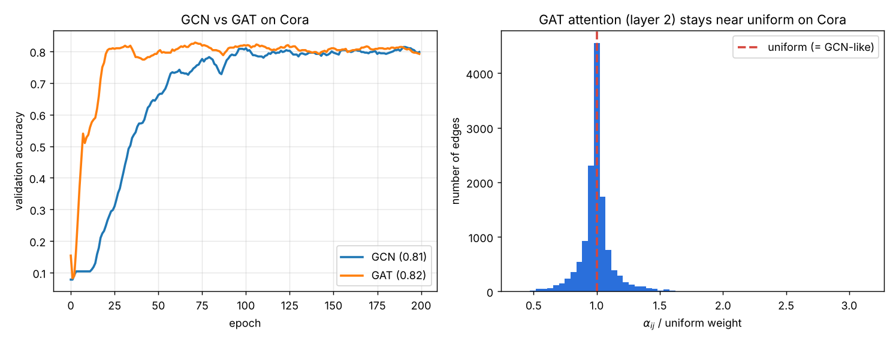
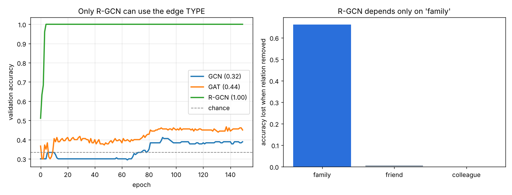
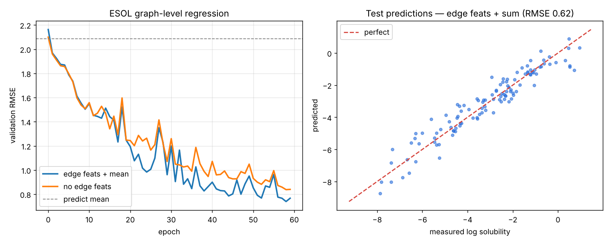

<div align="center">

# Graph Neural Networks — From Scratch

**From graph fundamentals to molecular property prediction**  
A hands-on, lecture-aligned guide to **GCN · GAT · R-GCN · Edge-aware MPNNs**


**[Quick start](#quick-start) · [Experiment gallery](#experiment-gallery) · [Learning roadmap](#learning-roadmap) · [Repository structure](#repository-structure)**

</div>

> [!IMPORTANT]
> **Educational and research-oriented repository.** The experiments reproduce concepts from two lectures by **Vinh Dinh Nguyen** (*Introduction to Graph Neural Network* and *Advanced Graph Neural Network*). Cora is a citation network; ESOL models molecular solubility, a property relevant to molecular research. This project **does not provide patient-level medical diagnosis or clinical validation**.

## Overview

This repository implements graph representation learning with **plain PyTorch**—no PyTorch Geometric, DGL, NetworkX, or `torch-scatter`. It includes **six experiments**, six theory chapters, correctness tests, and saved figures.

**What you will learn**

- Why graphs require **permutation-aware** neural networks.
- How to implement sparse **message passing** using `Tensor.index_add_`.
- How **GCN**, **GAT**, and **R-GCN** differ in their treatment of neighbors and edge information.
- Why deeper GNNs can suffer from **over-smoothing**.
- How **molecular graphs** produce whole-graph predictions through permutation-invariant pooling.

### Two prediction settings

| | Node-level prediction | Graph-level prediction |
|---|---|---|
| Dataset | **Cora** citation graph | **ESOL** molecules |
| Node | Scientific paper | Atom |
| Edge | Citation link | Chemical bond |
| Features | Bag-of-words | Atom and bond attributes |
| Output | Topic per paper (7 classes) | Predicted water solubility per molecule |
| Example model | GCN / GAT | Edge-aware GNN + pooling |
| Experiment | [02](experiments/02_cora_mlp_vs_gcn.py), [04](experiments/04_cora_gat.py) | [06](experiments/06_esol_graph_regression.py) |

> [!NOTE]
> **About RDKit:** It is used only in ESOL to parse SMILES strings into atoms and bonds. The graph representations, batching, neural layers, losses, and training loops are implemented in this repository.

## Architecture at a glance



### One mathematical idea: message passing

For node \(u\), layer \(k\) combines its current representation with messages from the neighborhood \(\mathcal N(u)\):

$$
h_u^{(k+1)}
=
\operatorname{UPDATE}^{(k)}
\left(
h_u^{(k)},
\operatorname{AGGREGATE}^{(k)}
\left(\{h_v^{(k)}:v\in\mathcal N(u)\}\right)
\right).
$$

The aggregation must not depend on the arbitrary ordering of neighbors. That is what makes the network **permutation-equivariant** at node level. A symmetric graph readout then produces a **permutation-invariant** graph-level output.

### GCN: fixed, degree-normalized aggregation

$$
\widetilde A=A+I,\qquad
\widehat A=\widetilde D^{-1/2}\widetilde A\widetilde D^{-1/2}
$$

$$
H^{(k+1)}=\sigma\!\left(\widehat A H^{(k)}W^{(k)}\right).
$$

The code evaluates the sparse equivalent using edge indices and scatter-add; it **does not** materialize a dense adjacency matrix during normal training.

### What changes in the advanced architectures?

| Architecture | Key equation | What changes? |
|---|---|---|
| **GCN** | \(\sum_{v\in\mathcal N(u)}\widehat A_{uv}Wh_v\) | Fixed weights from graph degree |
| **GAT** | \(\sum_{v\in\mathcal N(u)}\alpha_{uv}Wh_v\) | **Learned attention** over neighbors |
| **R-GCN** | \(\sum_r\sum_{v\in\mathcal N_r(u)}c_{u,r}^{-1}W_rh_v\) | **Separate transform per relation type** |
| **Edge MPNN** | \(m_{uv}=\operatorname{MLP}([h_u\Vert h_v\Vert e_{uv}])\) | Messages use **multi-dimensional edge features** |

See [message passing and GCN](docs/02-message-passing-and-gcn.md), [edge features and relations](docs/04-edge-features-and-relations.md), and [attention and graph pooling](docs/05-attention-and-graph-level.md) for full derivations.

---

## Quick start

**Prerequisite:** Python 3.10+, basic PyTorch and neural-network training knowledge. A CPU is sufficient for the learning exercises; running all experiments may take longer.

```bash
git clone https://github.com/AIVIETNAM-AIO-khaisiubeo/Medical-GraphNeuralNetwork.git
cd Medical-GraphNeuralNetwork

python -m pip install -r requirements.txt
python scripts/download_data.py
python tests/test_core.py
```

Run the main node-classification comparison:

```bash
python experiments/02_cora_mlp_vs_gcn.py
```

Run the ESOL molecular graph regression:

```bash
python experiments/06_esol_graph_regression.py
```

Data is downloaded by the project script; use the repo root as the working directory. The test suite checks sparse aggregation and properties such as permutation equivariance.

## Experiment gallery

The numbers below are the **saved runs documented by this repository**, not a multi-seed clinical benchmark. They should be interpreted within their respective datasets and splits.

### 01 · Karate Club — graph structure before training

Examine neighborhood propagation and community structure, including what randomly initialized graph layers do *and do not* reveal.

**[Run experiment](experiments/01_karate_untrained.py)** · [Relevant theory](docs/02-message-passing-and-gcn.md)



### 02 · Cora — MLP versus GCN

| Architecture | Test accuracy |
|---|---:|
| MLP, features only | 0.537 |
| GCN, two message-passing layers + linear head | 0.765 |
| **Canonical GCN, final convolution emits logits** | **0.810** |
| GAT (8 heads; experiment 04) | 0.818 |

The 0.810 GCN exceeds the MLP by **0.273 absolute accuracy points** on this saved run. This comparison illustrates how citation topology can improve predictions from limited node labels.

**[Run experiment](experiments/02_cora_mlp_vs_gcn.py)** · [GCN derivation](docs/02-message-passing-and-gcn.md)



### 03 · Over-smoothing — why greater depth can fail

| GCN layers | 1 | **2** | 3 | 4 | 5 | 6 | 8 |
|---|---:|---:|---:|---:|---:|---:|---:|
| Test accuracy | 0.652 | **0.810** | 0.743 | 0.510 | 0.138 | 0.151 | 0.082 |
| MAD | 0.682 | 0.319 | 0.335 | 0.288 | 0.046 | 0.001 | 0.010 |

Repeated smoothing can make embeddings less distinguishable. The [over-smoothing chapter](docs/03-over-smoothing.md) explains MAD and MADGap and discusses mitigation strategies.



### 04 · GAT — attention over graph neighborhoods

GAT replaces the fixed GCN aggregation coefficients with learned, edge-local attention:

$$
e_{uv}=\operatorname{LeakyReLU}\!\left(a^\top[Wh_u\Vert Wh_v]\right),
\qquad
\alpha_{uv}=\frac{\exp(e_{uv})}
{\sum_{j\in\mathcal N(u)}\exp(e_{uj})}.
$$

On the saved Cora run, **GAT = 0.818** versus **GCN = 0.810** test accuracy. This is a small difference, not proof that attention is always better.

**[Run experiment](experiments/04_cora_gat.py)** · [GAT chapter](docs/05-attention-and-graph-level.md)



### 05 · R-GCN — relation types carry information

A synthetic relational graph has three edge types; only one type reliably carries the label signal.

$$
h_u'=W_0h_u+\sum_{r\in\mathcal R}
\frac{1}{|\mathcal N_r(u)|}
\sum_{v\in\mathcal N_r(u)}W_rh_v.
$$

| Model | Test accuracy |
|---|---:|
| GCN (relation-blind) | 0.322 |
| GAT (node-feature attention) | 0.439 |
| **R-GCN (relation-specific weights)** | **1.000** |

This is a **designed synthetic task**—the result illustrates when edge type matters, not general superiority across datasets.

**[Run experiment](experiments/05_rgcn_relations.py)** · [Relations chapter](docs/04-edge-features-and-relations.md)



### 06 · ESOL — molecular graph regression

Atoms are nodes; chemical bonds are edges with features. After message passing, node embeddings are pooled into a molecular representation:

$$
h_G=\operatorname{POOL}\!\left(\{h_v:v\in V(G)\}\right),
\qquad \widehat y_G=\operatorname{MLP}(h_G).
$$

| Configuration | Test RMSE ↓ |
|---|---:|
| Predict training mean | 2.087 |
| GNN without bond attributes | 0.937 |
| GNN with bond attributes, mean pooling | 0.864 |
| **GNN with bond attributes, sum pooling** | **0.621** |
| GNN with bond attributes, max pooling | 0.980 |

In this experiment, **bond features** and the choice of **pooling** both affect model performance. A sum readout preserves information related to the size of a graph; the experiment does not establish a universal best pooling method.

**[Run experiment](experiments/06_esol_graph_regression.py)** · [Graph-level prediction chapter](docs/05-attention-and-graph-level.md)



---

## Learning roadmap

The documents are written for readers familiar with **neural networks, deep learning, and Transformers**. Read them alongside the corresponding code instead of treating the mathematics as a separate subject.

| Order | Reading | Main questions |
|---|---|---|
| 00 | **[Tóm tắt tiếng Việt](docs/00-tom-tat-tieng-viet.md)** | Tổng quan các khái niệm và kết quả |
| 01 | [Graph data and tasks](docs/01-graph-data-and-tasks.md) | What are nodes, edges, equivariance, and sparse COO graphs? |
| 02 | [Message passing and GCN](docs/02-message-passing-and-gcn.md) | How is \(\widehat AHW\) derived and implemented? |
| 03 | [Over-smoothing](docs/03-over-smoothing.md) | Why do deep GNN embeddings become similar? |
| 04 | [Edge features and relations](docs/04-edge-features-and-relations.md) | When do edge weights and relation-specific parameters help? |
| 05 | [Attention and graph-level prediction](docs/05-attention-and-graph-level.md) | How does GAT differ from Transformer attention, and how does pooling work? |

<details>
<summary><strong>Slide-to-implementation map</strong></summary>

| Lecture topic | Code |
|---|---|
| Sparse graphs, adjacency lists | [`gnn/graph.py`](gnn/graph.py) |
| Message passing and graph convolution | [`gnn/layers.py`](gnn/layers.py) |
| Cora node classification, MLP versus GCN | [Experiment 02](experiments/02_cora_mlp_vs_gcn.py) |
| Over-smoothing, MAD, MADGap, NGNN | [Experiment 03](experiments/03_oversmoothing.py) |
| GAT and learned attention | [Experiment 04](experiments/04_cora_gat.py) |
| Relational GNN | [Experiment 05](experiments/05_rgcn_relations.py) |
| Multi-dimensional edge features and graph pooling | [Experiment 06](experiments/06_esol_graph_regression.py) |
| Vision GNN | Discussed in slides; **not implemented** |

</details>

## Repository structure

```text
Medical-GraphNeuralNetwork/
├── README.md
├── requirements.txt
├── gnn/
│   ├── graph.py              # Sparse COO graphs, scatter ops, batching, pooling
│   ├── layers.py             # GCNLayer, GATLayer, RGCNLayer, EdgeMPNNLayer
│   ├── models.py             # MLP, GCN, GAT, RGCN, GraphRegressor
│   ├── metrics.py            # Accuracy, RMSE, MAD and MADGap
│   ├── train.py              # Training and evaluation loops
│   └── data/                 # Cora, Karate, relational graphs, ESOL
├── experiments/
│   ├── 01_karate_untrained.py
│   ├── 02_cora_mlp_vs_gcn.py
│   ├── 03_oversmoothing.py
│   ├── 04_cora_gat.py
│   ├── 05_rgcn_relations.py
│   └── 06_esol_graph_regression.py
├── docs/                     # Six linked theory chapters
├── scripts/download_data.py
├── tests/test_core.py
└── results/                  # Six figures from the example runs
```

## Implementation principles

- **No prebuilt GNN layers:** forward passes use `torch.nn` and native PyTorch tensor operations.
- **Sparse aggregation:** `edge_index` and `index_add_` replace dense `N\times N` aggregation where appropriate.
- **Reproducibility checks:** [`tests/test_core.py`](tests/test_core.py) verifies graph utilities, sparse versus dense equivalence, and permutation behavior.
- **Educational comparisons:** experiments illustrate mechanisms; numerical results may vary by environment and training run.
- **Research boundaries:** results on Cora and ESOL do not imply clinical performance, causal interpretation, or drug suitability.

## References

1. Kipf & Welling (2017). [*Semi-Supervised Classification with Graph Convolutional Networks*](https://arxiv.org/abs/1609.02907).
2. Veličković et al. (2018). [*Graph Attention Networks*](https://arxiv.org/abs/1710.10903).
3. Schlichtkrull et al. (2018). [*Modeling Relational Data with Graph Convolutional Networks*](https://arxiv.org/abs/1703.06103).
4. Chen et al. (2020). [*Measuring and Relieving the Over-smoothing Problem for Graph Neural Networks from the Topological View*](https://arxiv.org/abs/1909.03211).
5. Gilmer et al. (2017). [*Neural Message Passing for Quantum Chemistry*](https://arxiv.org/abs/1704.01212).

<div align="center">

**Built to make GNN mathematics inspectable, runnable, and experimentally testable.**

[↑ Back to top](#graph-neural-networks--from-scratch)

</div>
